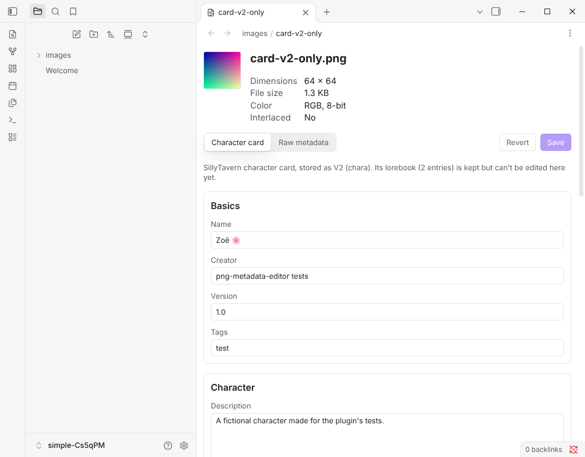
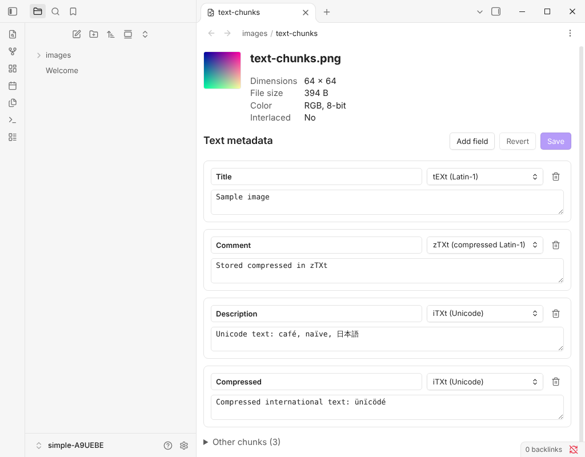
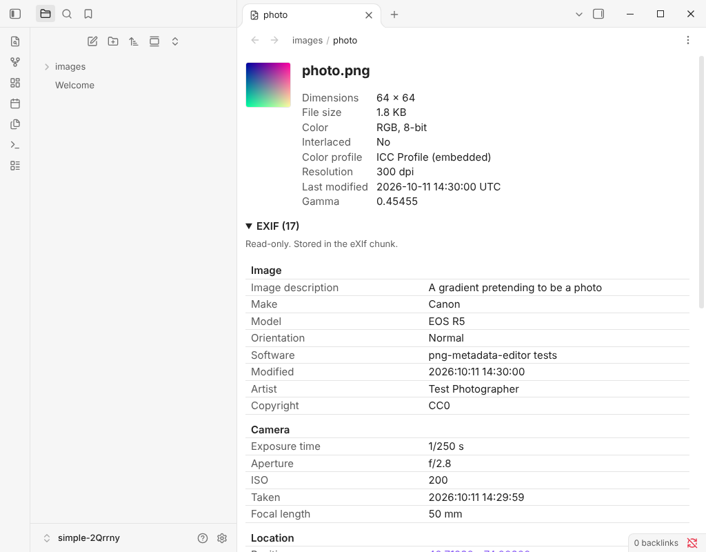

# PNG Metadata Editor

View and edit the metadata stored inside PNG files, right in Obsidian. It has a dedicated mode for SillyTavern character cards, which keep their character data inside the PNG.

## Features

- **Open PNGs in a metadata view.** Selecting a `.png` in the file explorer shows a preview, the image's basic properties and all of its metadata. You can turn this off in settings and open PNGs on demand instead.
- **Edit text metadata.** Every text field in the file (`tEXt`, `zTXt` and `iTXt` chunks) can be edited, added, deleted or switched between types, then saved. The image itself is never re-encoded.
- **SillyTavern character cards.** Cards are shown as a form (name, description, personality, scenario, greetings, prompts, tags and more), with a toggle back to the raw metadata. V1, V2 (`chara`) and V3 (`ccv3`) cards are supported. When a file has both chunks, edits are saved to both. Lorebooks and other data the form doesn't show are kept unchanged.
- **Standard metadata, read-only.** EXIF (from an `eXIf` chunk or an ImageMagick raw profile), XMP, and PNG info chunks such as resolution, modification time, gamma and color profile.

| Text metadata | Photo metadata |
| --- | --- |
|  |  |

## Installation

### From Community plugins

1. Open **Settings → Community plugins** and turn off **Restricted mode** if it is on.
2. Select **Browse**, search for **PNG Metadata Editor** and select **Install**.
3. Select **Enable**.

### Manually

1. Download `main.js`, `manifest.json` and `styles.css` from the [latest release](https://github.com/automandc/obsidian-png-metadata-editor/releases/latest).
2. Copy them into `<your vault>/.obsidian/plugins/png-metadata-editor/`.
3. Reload Obsidian and enable the plugin in **Settings → Community plugins**.

## Usage

- Select any PNG in the file explorer. If you turned off **Open PNG files in metadata view**, right-click the file and select **Open in metadata view**, or run **Open current PNG in metadata view** from the command palette.
- Edit fields, then select **Save**. **Revert** discards unsaved changes.
- For a SillyTavern card, use the **Character card** and **Raw metadata** tabs to switch between the form and the underlying fields.

## Settings

| Setting | Default | What it does |
| --- | --- | --- |
| Open PNG files in metadata view | On | Opens PNGs in this plugin instead of Obsidian's image viewer. |
| Back up before first save | On | Before a PNG is changed for the first time, keeps the original next to it as `NAME.png.bak`. |

## Privacy and safety

- The plugin works entirely offline. It makes no network requests and collects no data.
- It only reads and writes PNG files in your vault, and only writes when you select **Save**. With backups on, it also creates a `.png.bak` copy beside a file the first time you change it.
- Keep your own backups too. The file format code is well tested, but this is a young plugin.

## Limitations

- EXIF and XMP are shown but can't be edited.
- SillyTavern lorebooks are kept but can't be edited here.
- To open PNGs by default, the plugin takes over the `.png` extension from Obsidian's built-in image viewer using an internal Obsidian API. It hands it back when the plugin is disabled or the setting is turned off.

## Contributing

Bug reports, ideas and pull requests are welcome. See [CONTRIBUTING.md](CONTRIBUTING.md) for how to set up the project, run the tests and send a change.

## License

[MIT](LICENSE)
